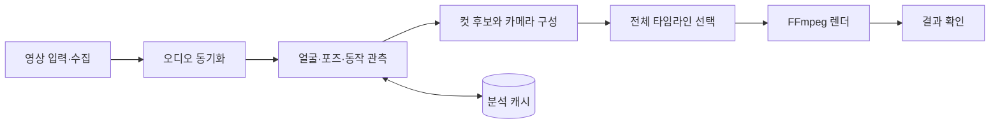

# CrossCut

**얼굴·동작·음악 타이밍을 연결하는 공연 영상 자동 교차편집 도구**

같은 곡을 촬영한 여러 무대 영상을 하나의 타임라인으로 편집하는 macOS 앱과 Python 엔진입니다. 오디오로 공연 시간을 맞추고, 컷 앞뒤의 얼굴 크기·포즈·움직임을 비교해 장면을 선택합니다. 단체 무대와 개인 직캠을 각각 편집하며, 개인 영상에는 의상 교체를 강조하는 디졸브를 적용할 수 있습니다.

편집 엔진은 입력 영상의 시청각 특징을 사용하며, 인물별 얼굴 가중치와 검색 카탈로그는 설정·데이터로 분리되어 있습니다.

## 대표 시연

기존 렌더 결과에서 선별한 구간입니다. 발췌 과정에서 컷 구성과 재생 속도를 유지했습니다.

### 클로즈업 연결 · I AM

전체 결과의 **00:51–00:57**. 컷 전후 얼굴 크기와 동작이 이어지는 구간입니다.

https://github.com/user-attachments/assets/d1d107bb-b16f-420e-bb7e-a39a3b5201e7

### 단체 교차편집 · XOXZ

2026-09-30 결과의 **00:55.5–01:13.4**. 여러 무대의 클로즈업과 안무를 연결한 구간입니다.

https://github.com/user-attachments/assets/15652c5a-2f12-48c8-95b5-2d77b694c56c

### 개인 직캠 · 의상 전환

**6초 시연**. 동작을 이어가며 의상이 전환되는 구간입니다.

https://github.com/user-attachments/assets/b8298175-d136-4b12-8cf3-72fb4c0d78ab

## 실제 문제 해결 사례

### 1. 세로 직캠의 분석 좌표와 실제 출력 화면이 어긋나는 문제

- **문제 상황:** 가로·세로 소스를 섞어 세로 직캠을 만들 때, 원본에서 계산한 얼굴·포즈 위치와 실제 잘라낸 화면의 위치가 달라졌습니다.
- **원인:** 원본과 출력의 화면 비율이 다른데도, 원본 기준 좌표만으로 컷 연결을 평가하면 실제로 보이는 영역을 반영하지 못했습니다.
- **수정:** 두 화면 비율로 실제 크롭 영역을 계산하고, 얼굴·포즈 좌표도 같은 영역을 기준으로 투영하도록 분리했습니다. 화면 밖으로 나간 신체 좌표는 그대로 남겨 가림·잘림을 판단할 수 있게 했습니다.
- **검증 결과:** 가로·세로 소스와 1배·1.5배 확대 조합에서 합성 마커를 FFmpeg로 출력했습니다. 예측 위치와 실제 마커 위치가 **3픽셀 이내**로 일치하고, 마커의 가로·세로 비율이 유지되는지 확인했습니다.

[수정 커밋](https://github.com/luna021839/crosscut/commit/7931ee8b0e19e8f6da5a3ee3375f8be702de632a) · [구현](engine/crosscut2/aspect_viewport.py) · [회귀 테스트](engine/tests/test_crosscut2_aspect_viewport.py)

### 2. 전환 효과만 수정해도 전체 영상을 다시 인코딩하는 문제

- **문제 상황:** 디졸브 적용 여부만 바꾸는 작업에도 전체 영상 렌더가 반복되어, 결과를 비교하고 다음 수정을 결정하기까지 불필요한 작업이 발생했습니다.
- **원인:** 소스·컷·카메라·시간축이 동일한 장면도 새 결과를 만드는 과정에서 다시 인코딩했습니다.
- **수정:** 편집 계획이 일치하는 기존 결과에서 필요한 장면을 골라, 독립 키프레임 경계에서 스트림 복사로 재조립하는 경로를 추가했습니다. 결과의 비디오·오디오 패킷 해시와 시간 정보를 대조해 재사용 과정의 누락·변형을 검사합니다.
- **검증 결과:** **4초·120프레임 합성 영상**의 전환 효과를 변경하는 테스트에서 재조립 단계의 **비디오 인코더 호출 0회**를 확인했습니다. 출력 프레임이 선택한 기존 장면과 동일하고, 오디오 패킷과 타임스탬프도 보존됨을 검증했습니다.

[수정 커밋](https://github.com/luna021839/crosscut/commit/b5edd7af6f0190ccfa0b33b7a6b9da567e11f7ce) · [구현](engine/crosscut2/encoded_programme_reuse.py) · [회귀 테스트](engine/tests/test_crosscut2_encoded_programme_reuse.py)

### 3. 의상 전환 중 얼굴 색감까지 바뀌어 보이는 문제

- **문제 상황:** 의상이 바뀌는 효과를 적용한 뒤, 전환 중 얼굴 색감 변화가 눈에 띈다는 결과 영상 피드백이 있었습니다.
- **원인:** 서로 다른 무대의 조명·피부색 차이가 남아 있는 상태에서 두 영상을 섞으면 얼굴의 색 차이도 함께 드러났습니다.
- **수정:** 얼굴 랜드마크로 볼 주변의 색을 비교하고, 짧은 전환 구간 전체에서 색 차이를 평활화한 뒤 얼굴 주변만 국소 보정했습니다. 의상·배경의 색과 전환 시작·끝 원본 프레임은 보존하도록 구성했습니다.
- **검증 결과:** 합성 색상 입력에서 두 얼굴의 색 차이가 줄어드는지 확인했습니다. 의상·배경 픽셀과 전환 양 끝 프레임이 유지되고, 한 프레임의 잘못된 색 샘플이 보정값을 흔들지 않는지도 회귀 테스트로 검증했습니다.

[수정 커밋](https://github.com/luna021839/crosscut/commit/d422890952e6a7a0995edc4b0074aa4108621fea) · [구현](engine/crosscut2/member_face_tone.py) · [회귀 테스트](engine/tests/test_crosscut2_member_face_tone.py)

## 본인 구현 범위

개인 프로젝트로 사용 시나리오와 기능 요구사항, 편집 품질 기준을 정하고, 실제 결과 영상의 비교·피드백과 개선 우선순위를 담당했습니다. 코드 구현·리팩터링·테스트 작성에는 생성형 AI 코딩 도구를 활용했습니다.

프로젝트에서 구성한 앱·엔진과 외부 구성요소의 범위는 다음과 같습니다.

| 구분 | 프로젝트 구현 범위 | 관련 코드 |
| --- | --- | --- |
| macOS 앱 | 편집 설정, 소스·출력 선택, 엔진 실행, 진행·취소·결과 상태 관리 | [SwiftUI 앱](CrossCutMac/Sources) |
| 분석 파이프라인 | 소스 수집·입력 검증, 오디오 정렬, 시각 특징 관측과 캐시 연결 | [분석 엔진](engine/crosscut) |
| 편집 선택 | 컷 후보 구성, 동작·구도 연결 비용, 전체 경로 선택과 카메라 보정 | [편집 모듈](engine/crosscut2) |
| 개인 영상 효과 | 포즈 기반 디졸브, 의상 영역 전환, 얼굴 색감 보정 | [의상 전환](engine/crosscut2/member_wardrobe_layer.py), [얼굴 색감](engine/crosscut2/member_face_tone.py) |
| 개발·검증 환경 | 앱 내 엔진 번들링, 회귀 테스트, GitHub Actions 구성 | [번들링](tools/bundle_engine.py), [테스트](engine/tests), [CI](.github/workflows/engine-checks.yml) |

영상 다운로드·인코딩에는 yt-dlp와 FFmpeg를, 얼굴·인물·포즈 관측에는 OpenCV와 사전 학습 모델을 활용했습니다. 외부 모델의 학습과 라이브러리 자체는 본인 구현 범위에 포함하지 않습니다. 학습 코드와 선택적 모델을 연결하는 실험 경로는 별도로 관리합니다.

## 개발 과정과 커밋 기록

2026-08-23부터 2026-10-18까지의 공개 가능한 실제 개발 커밋 **721개**를 연결했습니다. [개발 커밋 로그](https://github.com/luna021839/crosscut/commits/codex/development-history/)에서 코드 변경을, [개발 과정 문서](docs/DEVELOPMENT.md)에서 주요 단계와 개선 이유를 확인할 수 있습니다. 원본의 작성·커밋 시각을 유지했으며, 공개를 위해 개인 경로와 비공개 자료를 정리했습니다.

## 결과

- **영상 산출:** 개발 과정에서 단체 교차편집과 개인 직캠의 전체 곡 렌더를 제작하고 비교했습니다. 개인 영상에는 의상 교체 디졸브와 얼굴 색감 보정을 적용했습니다.
- **작업 흐름:** 소스 입력·수집부터 동기화, 관측, 타임라인 선택과 렌더까지 연결하고, macOS 앱에서 작업 진행과 결과를 확인하도록 구현했습니다.
- **코드 검증:** 공개본 기준 핵심 회귀 테스트 **215개**, Python 소스 문법 검사·CLI 도움말 실행, macOS Debug 빌드와 엔진 번들링을 통과했습니다. [GitHub CI 실행 결과](https://github.com/luna021839/crosscut/actions/runs/43364516019)도 확인할 수 있습니다.

현재 개선 중인 항목은 방송사별 구도·조명·가림 차이, 과도한 확대, 컷 밀도와 동작 연결의 균형입니다. 대표 발췌 영상은 위에서 재생할 수 있으며, 전체 렌더와 원본은 저장소에 포함하지 않습니다. 코드 검증의 범위와 재현 명령은 [검증 문서](docs/VALIDATION.md)에 기록했습니다.

## 주요 기능

| 기능 | 구현 내용 |
| --- | --- |
| 영상 수집·입력 | 곡 정보 기반 소스 검색과 다운로드, 로컬 영상 입력, 소스 캐시 |
| 오디오 동기화 | 공통 음악 시간축 추정, 소스별 오프셋과 시간 오차 보정 |
| 동작을 잇는 컷 선택 | 얼굴 위치·크기, 신체 포즈, 동작 방향과 원본 카메라 컷을 비교 |
| 전체 타임라인 최적화 | 전환 연결성, 샷 길이, 화면 구도와 소스 재사용을 함께 고려 |
| 가상 카메라 | 컷 양쪽의 피사체 위치와 크기를 맞추는 이동·확대·회전 |
| 개인 직캠 효과 | 포즈 기반 디졸브, 의상 영역 전환, 얼굴 색감 보정 |
| macOS 작업 흐름 | 편집 모드·소스·출력 설정, 진행 상황 표시, 취소와 결과 확인 |

## 처리 구조



SwiftUI 앱은 작업 설정과 프로세스 수명 주기를 담당합니다. Python 엔진은 분석·선택·렌더 계획을 수행하며, JSON Lines 이벤트로 진행 상황과 결과를 앱에 전달합니다. 단체 영상은 여러 인물의 구도와 클로즈업 연결을, 개인 직캠은 한 인물의 포즈와 동작 연결을 중심으로 다룹니다.

구체적인 모듈 연결은 [아키텍처 문서](docs/ARCHITECTURE.md)에서 설명합니다.

## 기술 스택

| 영역 | 사용 기술 |
| --- | --- |
| 데스크톱 앱 | Swift, SwiftUI, macOS 14+, XcodeGen |
| 영상·오디오 | Python 3.11+, FFmpeg / FFprobe, OpenCV, NumPy, SciPy |
| 영상 수집·컷 감지 | yt-dlp, PySceneDetect, TransNetV2 |
| 시각 특징 | YuNet, SFace, 포즈 추정, 인물·실루엣 관측 |
| 편집 선택 | 동적 계획법, 제한 탐색, 기하·동작 기반 비용 함수 |
| 학습 실험 | 선호도 모델, 시퀀스 모델, MLX 기반 Transformer 학습 코드 |

학습 실험 코드와 기본 편집 경로는 구분되어 있습니다. 선택 모델·가중치·캐시에 따라 사용할 수 있는 경로가 달라집니다.

## 실행

### Python 엔진

```bash
git clone https://github.com/luna021839/crosscut.git
cd crosscut
brew install ffmpeg python@3.11 xcodegen
python3.11 -m venv .venv
source .venv/bin/activate
python -m pip install -e ./engine
python engine/crosscut_cli.py --help
python engine/crosscut_cli.py doctor
```

`doctor`는 FFmpeg, 모델과 선택적 런타임의 준비 상태를 확인합니다. 기본 OpenCV 모델은 저장소에 포함되어 있으며, 추가 학습 가중치·개인 얼굴 데이터·공연 원본은 포함하지 않습니다.

### macOS 앱

```bash
cd CrossCutMac
xcodegen generate
open CrossCutMac.xcodeproj
```

Xcode에서 `CrossCutMac` 스킴을 실행합니다. Python을 별도로 지정하려면 앱 실행 환경에 `CROSSCUT_PYTHON`을 설정합니다. 엔진 위치를 바꾸는 경우 `CROSSCUT_ENGINE`을 사용합니다. 출력·소스 폴더는 앱에서 선택할 수 있습니다.

## 코드 탐색

```text
CrossCutMac/       SwiftUI 앱, 엔진 통신, 작업·결과 상태
engine/crosscut/   입력 검증, 수집·동기화, 공통 영상 처리와 기존 파이프라인
engine/crosscut2/  컷·동작 연결, 전체 경로 선택, 개인 직캠·의상 전환
engine/tests/     합성 데이터와 고정 입력을 사용하는 회귀 테스트
tools/            엔진 번들링, 관측·분석·학습 보조 도구
docs/             아키텍처, 검증 방법, 외부 모델 출처
```

## 모델·자료 출처

기본 모델의 라이선스와 알고리즘 참고 자료는 [외부 구성요소 문서](docs/THIRD_PARTY.md)에 정리했습니다. 이 저장소는 코드와 재현에 필요한 기본 모델을 공개하고, 기존 결과물의 짧은 발췌를 시연으로 연결합니다. 공연 원본·음원 파일·개인 얼굴 데이터·전체 렌더는 포함하지 않습니다.
