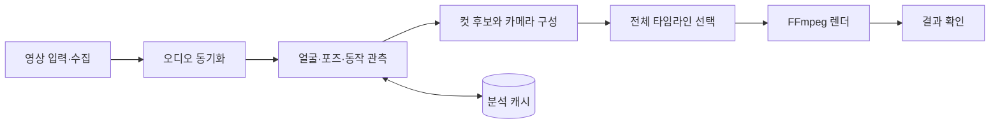

# CrossCut

**얼굴·동작·음악 타이밍을 연결하는 공연 영상 자동 교차편집 도구**

같은 곡을 촬영한 여러 무대 영상을 하나의 타임라인으로 편집하는 macOS 앱과 Python 엔진입니다. 오디오로 공연 시간을 맞추고, 컷 앞뒤의 얼굴 크기·포즈·움직임을 비교해 장면을 선택합니다. 단체 무대와 개인 직캠을 각각 편집하며, 개인 영상에는 의상 교체를 강조하는 디졸브를 적용할 수 있습니다.

편집 엔진은 입력 영상의 시청각 특징을 사용하며, 인물별 얼굴 가중치와 검색 카탈로그는 설정·데이터로 분리되어 있습니다.

## 주요 기능

| 기능 | 구현 내용 |
| --- | --- |
| 영상 수집·입력 | 곡 정보 기반 소스 검색과 다운로드, 로컬 영상 입력, 소스 캐시 |
| 오디오 동기화 | 공통 음악 시간축 추정, 소스별 오프셋과 시간 오차 보정 |
| 동작을 잇는 컷 선택 | 얼굴 위치·크기, 신체 포즈, 동작 방향과 원본 카메라 컷을 비교 |
| 전체 타임라인 최적화 | 전환 연결성, 샷 길이, 화면 구도와 소스 재사용을 함께 고려 |
| 가상 카메라 | 컷 양쪽의 피사체 위치와 크기를 맞추는 이동·확대·회전 |
| 개인 직캠 효과 | 포즈 기반 디졸브, 의상 영역 전환, 얼굴 색감 보정 |
| macOS 작업 흐름 | 편집 모드·소스·출력 설정, 진행 상황 표시, 취소와 결과 확인 |

## 처리 구조



SwiftUI 앱은 작업 설정과 프로세스 수명 주기를 담당합니다. Python 엔진은 분석·선택·렌더 계획을 수행하며, JSON Lines 이벤트로 진행 상황과 결과를 앱에 전달합니다. 단체 영상은 여러 인물의 구도와 클로즈업 연결을, 개인 직캠은 한 인물의 포즈와 동작 연결을 중심으로 다룹니다.

## 기술적으로 다룬 문제

- **박자만 맞는 컷의 한계:** 음악 시간축과 함께 실제 출력 화면에서 얼굴 크기·피사체 위치·동작을 비교합니다.
- **구간별 선택이 만드는 단조로움:** 개별 컷 점수와 샷 유지 시간, 이전·다음 장면의 관계를 전체 경로 선택에 반영합니다.
- **디지털 확대의 부작용:** 카메라 변환을 컷 선택과 함께 평가하고, 화면 경계·가독성·변환 속도를 점검합니다.
- **반복 분석 비용:** 소스·시각·모델 정보에 연결된 관측 캐시를 재사용하고, 탐색과 디코딩 작업량을 제한합니다.
- **편집 모드별 요구 차이:** 단체 구도, 개인 동작 연결, 의상 교체 효과를 구분한 파이프라인을 구성합니다.

구체적인 모듈 연결은 [아키텍처 문서](docs/ARCHITECTURE.md)에서 설명합니다.

## 기술 스택

| 영역 | 사용 기술 |
| --- | --- |
| 데스크톱 앱 | Swift, SwiftUI, macOS 14+, XcodeGen |
| 영상·오디오 | Python 3.11+, FFmpeg / FFprobe, OpenCV, NumPy, SciPy |
| 영상 수집·컷 감지 | yt-dlp, PySceneDetect, TransNetV2 |
| 시각 특징 | YuNet, SFace, 포즈 추정, 인물·실루엣 관측 |
| 편집 선택 | 동적 계획법, 제한 탐색, 기하·동작 기반 비용 함수 |
| 학습 실험 | 선호도 모델, 시퀀스 모델, MLX 기반 Transformer 학습 코드 |

학습 실험 코드와 기본 편집 경로는 구분되어 있습니다. 선택 모델·가중치·캐시에 따라 사용할 수 있는 경로가 달라집니다.

## 실행

### Python 엔진

```bash
git clone https://github.com/luna021839/crosscut.git
cd crosscut
brew install ffmpeg python@3.11 xcodegen
python3.11 -m venv .venv
source .venv/bin/activate
python -m pip install -e ./engine
python engine/crosscut_cli.py --help
python engine/crosscut_cli.py doctor
```

`doctor`는 FFmpeg, 모델과 선택적 런타임의 준비 상태를 확인합니다. 기본 OpenCV 모델은 저장소에 포함되어 있으며, 추가 학습 가중치·개인 얼굴 데이터·공연 원본은 포함하지 않습니다.

### macOS 앱

```bash
cd CrossCutMac
xcodegen generate
open CrossCutMac.xcodeproj
```

Xcode에서 `CrossCutMac` 스킴을 실행합니다. Python을 별도로 지정하려면 앱 실행 환경에 `CROSSCUT_PYTHON`을 설정합니다. 엔진 위치를 바꾸는 경우 `CROSSCUT_ENGINE`을 사용합니다. 출력·소스 폴더는 앱에서 선택할 수 있습니다.

## 코드 탐색

```text
CrossCutMac/       SwiftUI 앱, 엔진 통신, 작업·결과 상태
engine/crosscut/   입력 검증, 수집·동기화, 공통 영상 처리와 기존 파이프라인
engine/crosscut2/  컷·동작 연결, 전체 경로 선택, 개인 직캠·의상 전환
engine/tests/     합성 데이터와 고정 입력을 사용하는 회귀 테스트
tools/            엔진 번들링, 관측·분석·학습 보조 도구
docs/             아키텍처, 검증 방법, 외부 모델 출처
```

## 검증과 현재 상태

회귀 테스트는 시간축, 출력 프레임 구성, 카메라 기하와 입력 계약의 오류를 확인합니다. 영상 편집 품질은 실제 재생을 통해 별도로 평가합니다. 공개본의 확인 범위와 재현 명령은 [검증 문서](docs/VALIDATION.md)에 기록합니다.

개발 중인 프로젝트입니다. 여러 방송사의 화면 크기·조명·가림 차이, 자동 카메라의 과도한 확대, 컷 밀도와 동작 연결의 균형을 계속 개선하고 있습니다.

## 모델·자료 출처

기본 모델의 라이선스와 알고리즘 참고 자료는 [외부 구성요소 문서](docs/THIRD_PARTY.md)에 정리했습니다. 이 저장소는 코드와 재현에 필요한 기본 모델을 공개하며, 방송 영상·음원·개인 얼굴 데이터·개발 중 생성된 영상은 배포하지 않습니다.
